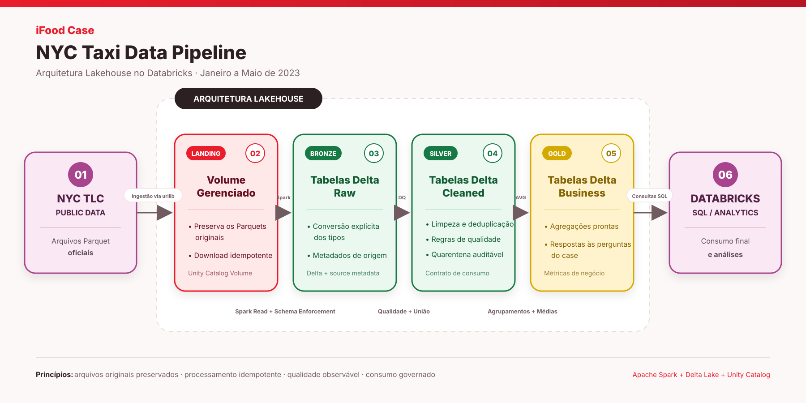

# NYC Taxi Data Pipeline — Case iFood

Solução do case técnico de Data Architect do iFood. O pipeline ingere os
dados públicos de **Yellow** e **Green Taxi** da NYC TLC entre janeiro e maio
de 2023, aplica tratamento com PySpark e disponibiliza tabelas Delta para
consumo SQL.

## O que a solução entrega

- aquisição automática dos Parquets oficiais da NYC TLC;
- preservação dos arquivos originais em uma Landing Zone;
- tabelas Bronze com schema técnico e rastreabilidade;
- tabelas Silver validadas, deduplicadas e prontas para consumo;
- quarentena com os registros rejeitados e seus motivos;
- tabelas Gold e consultas SQL para as duas perguntas do case;
- análise exploratória com volumetria e indicadores de qualidade.

## Arquitetura



| Etapa | Tecnologia | Responsabilidade |
|---|---|---|
| Fonte | NYC TLC / Parquet | disponibilizar os arquivos oficiais de Yellow e Green Taxi |
| Landing | Unity Catalog Volume | preservar os arquivos originais e evitar downloads repetidos |
| Bronze | Delta Lake | aplicar o contrato técnico e adicionar rastreabilidade |
| Silver | PySpark / Delta Lake | padronizar, validar, deduplicar e separar a quarentena |
| Gold | PySpark / Delta Lake | materializar as agregações das perguntas do case |
| Consumo | Databricks SQL | consultar e validar os resultados com SQL |

Detalhes em [docs/architecture.md](docs/architecture.md) e
[docs/decisions.md](docs/decisions.md).

## Pré-requisitos

- uma conta no Databricks Free Edition;
- acesso a este repositório no GitHub;
- acesso de saída do workspace ao endpoint público da NYC TLC;
- compute Serverless disponível.

Não é necessário instalar Python, PySpark ou Databricks Connect para executar
o case. O Databricks já fornece Spark, Delta Lake e `dbutils`.

> O enunciado menciona a antiga Community Edition. A Free Edition é sua
> substituta atual e permite executar o case com Serverless, Unity Catalog e
> Volumes, sem exigir uma conta de nuvem externa.

## Execução completa no Databricks

### 1. Adicionar o repositório ao workspace

1. No Databricks, abra **Workspace**.
2. Selecione **Create > Git folder**.
3. Informe a URL deste repositório:
   `https://github.com/eliandersonn/ifood-case`.
4. Se o repositório estiver privado, conecte sua conta GitHub em
   **Settings > Linked accounts** e autorize o acesso ao repositório.
5. Abra a pasta Git criada e confirme que `src/`, `analysis/` e `docs/`
   estão disponíveis.

### 2. Executar o pipeline

Abra cada arquivo e use **Run all**, selecionando o compute **Serverless**.
Execute exatamente nesta ordem:

1. `src/00_setup.py`
   - cria os schemas Bronze, Silver e Gold;
   - cria o Volume gerenciado usado como Landing Zone.
2. `src/01_bronze_ingestion.py`
   - baixa os dez Parquets oficiais;
   - valida os arquivos e as colunas obrigatórias;
   - publica as tabelas Delta Bronze.
3. `src/02_silver_transformation.py`
   - padroniza Yellow e Green Taxi;
   - aplica qualidade e deduplicação;
   - publica Silver e quarentena;
   - valida contrato e reconciliação entre as camadas.
4. `src/03_gold_analytics.py`
   - calcula e publica as duas respostas analíticas;
   - valida a cobertura dos meses e das 24 horas esperadas.

O notebook Bronze possui os parâmetros:

| Parâmetro | Padrão | Finalidade |
|---|---|---|
| `start_month` | `2023-01` | primeiro mês processado |
| `end_month` | `2023-05` | último mês processado |

Para reproduzir o case, mantenha os valores padrão. Para acrescentar junho,
por exemplo, altere apenas `end_month` para `2023-06`.

> **Observação sobre o ambiente gratuito:** o Databricks Free Edition limita o
> acesso de saída a um conjunto de domínios confiáveis. Por isso, alguns
> workspaces gratuitos podem apresentar `Temporary failure in name resolution`
> ao acessar a NYC TLC, mesmo com o código correto. Essa é uma restrição do
> ambiente de avaliação gratuito, não uma falha da lógica de ingestão. Em um
> workspace Enterprise, o acesso ao endpoint deve ser permitido pela política
> de rede administrada pela organização. Consulte as
> [limitações oficiais do Free Edition](https://docs.databricks.com/aws/en/getting-started/free-edition-limitations).

Se a política de rede bloquear o download automático, existem duas alternativas
de contingência sem alterar o restante do pipeline:

1. baixar os dez arquivos pela página oficial da NYC TLC e enviá-los manualmente
   pelo Catalog Explorer para o Volume `workspace.nyc_taxi_bronze.landing`,
   localizado em `/Volumes/workspace/nyc_taxi_bronze/landing`; ou
2. executar o download em uma máquina ou processo com acesso à internet e
   automatizar o envio ao mesmo Volume com Databricks CLI ou API.

Após o envio, reexecute `src/01_bronze_ingestion.py`. O notebook reconhece os
arquivos existentes, ignora um novo download e continua a publicação da Bronze.
Em ambientes Enterprise, a liberação ou o bloqueio do endpoint externo é uma
decisão da política interna de segurança e rede da organização.

### 3. Validar a execução

Ao final dos notebooks, confirme no **Catalog** a existência dos schemas:

```text
workspace.nyc_taxi_bronze
workspace.nyc_taxi_silver
workspace.nyc_taxi_gold
```

O notebook Silver interrompe a execução se o contrato obrigatório estiver
incompleto ou se os volumes de Yellow, Green, Silver unificada, quarentena e
duplicidades não fecharem com a Bronze. O notebook Gold também falha se não
publicar todos os meses disponíveis ou as 24 horas esperadas para maio.

Para o recorte original do case, as principais volumetrias esperadas são:

| Validação | Registros |
|---|---:|
| Bronze Yellow | 16.186.386 |
| Bronze Green | 339.630 |
| Silver válida | 16.373.639 |
| Quarentena | 152.239 |

Uma diferença de volumetria deve ser investigada antes de interpretar as
métricas, pois a fonte oficial pode publicar uma nova versão dos arquivos.

### 4. Executar as análises SQL

Execute os arquivos da pasta `analysis/`:

1. `00_data_quality_overview.sql` — perfil e qualidade dos dados;
2. `01_yellow_monthly_amount.sql` — valor médio de `total_amount` por corrida
   Yellow, agrupado pelo mês de início da corrida;
3. `02_may_hourly_passengers.sql` — quantidade média de passageiros por
   corrida Yellow ou Green iniciada em cada hora do dia, durante maio;
4. `03_executive_insights.sql` — variação mensal, rankings de volume e de
   passageiros médios por corrida, além da participação de Yellow e Green.

Os SQLs `01` e `02` calculam as respostas diretamente a partir da Silver. As
tabelas Gold materializam os mesmos resultados para consumo recorrente, e o
SQL `03` demonstra como consumidores podem relacionar essas métricas sem criar
uma nova camada.

### Definição das métricas

| Campo | Definição |
|---|---|
| `avg_total_amount` | média de `total_amount` entre as corridas Yellow válidas iniciadas em cada mês; representa valor total médio por corrida, não gasto médio por passageiro |
| `sum_total_amount` | soma de `total_amount` das corridas Yellow válidas do mês; informação complementar à média solicitada |
| `avg_passenger_count` | média de `passenger_count` entre as corridas Yellow e Green válidas, com contagem positiva, iniciadas em cada hora de maio; unidade: passageiros por corrida |
| `trip_count` | quantidade de corridas que participou do cálculo na linha correspondente |

## Qualidade dos dados

O pipeline aplica controles objetivos e mantém os registros rejeitados em
quarentena, sem apagá-los silenciosamente:

| Dimensão | Controle aplicado |
|---|---|
| Conformidade | validação das colunas obrigatórias e conversão explícita de tipos |
| Completude | campos essenciais não podem ser nulos |
| Validade | `total_amount` deve ser positivo e a duração deve ser maior que zero e de no máximo 24 horas |
| Consistência | pickup deve pertencer ao mês indicado pelo arquivo de origem |
| Unicidade | remoção de registros coincidentes segundo uma chave composta |
| Rastreabilidade | `source_file`, `source_month` e `ingested_at` na Bronze |
| Reconciliação | contagens por tipo, mês e camada ao final de cada etapa |

Como a fonte não fornece um identificador único de corrida no recorte utilizado,
a premissa de unicidade usa a chave composta por `VendorID`, `passenger_count`,
`total_amount`, horários de pickup e dropoff e categoria do táxi. Registros com
todos esses atributos coincidentes são tratados como duplicidades pelo pipeline.

`passenger_count` nulo ou não positivo não invalida uma corrida financeira.
Esses registros permanecem na Silver, mas são excluídos da métrica de média de
passageiros. A análise exploratória identificou essas ocorrências como dados
inadequados para representar indivíduos transportados; incluí-las reduziria a
média artificialmente.

### Regras de quarentena

Uma corrida é enviada para
`workspace.nyc_taxi_silver.taxi_trips_quarantine` quando viola pelo menos uma
das regras abaixo. A coluna `dq_failures` preserva todos os motivos encontrados.

| Código | Condição que reprova a corrida | Ocorrências observadas |
|---|---|---:|
| `null_vendor_id` | `VendorID` nulo | 0 |
| `null_total_amount` | `total_amount` nulo | 0 |
| `non_positive_total_amount` | `total_amount` menor ou igual a zero | 145.444 |
| `null_pickup_datetime` | data e hora de início nula | 0 |
| `null_dropoff_datetime` | data e hora de término nula | 0 |
| `non_positive_trip_duration` | término anterior ou igual ao início | 6.596 |
| `trip_duration_over_24h` | duração superior a 24 horas | 94 |
| `pickup_outside_source_month` | início da corrida fora do mês declarado pelo arquivo | 485 |

As ocorrências somam mais que os 152.239 registros em quarentena porque uma
mesma corrida pode violar mais de uma regra. Os 138 registros coincidentes na
chave composta são removidos separadamente e não integram a quarentena.

## Idempotência e novos meses

- arquivos válidos já presentes na Landing não são baixados novamente;
- as tabelas usam full refresh para tornar o recorte pequeno do case simples e
  determinístico;
- uma nova execução substitui as tabelas e não duplica registros.

## Próximos passos — evolução para produção

Para um histórico de vários anos, o pipeline deixaria de reconstruir todo o
período:

1. detectar somente os meses novos ou alterados;
2. usar `replaceWhere` por `source_month` ou `MERGE INTO` para atualizações;
3. recalcular somente as partições Gold afetadas;
4. executar as etapas em um Job com alertas de falha, volumetria e qualidade.

O particionamento e os metadados atuais permitem essa evolução sem alterar o
modelo de dados.

## Fonte de dados

- Catálogo oficial: [NYC TLC Trip Record Data](https://www.nyc.gov/site/tlc/about/tlc-trip-record-data.page).
- Endpoint físico dos Parquets:
  `https://d37ci6vzurychx.cloudfront.net/trip-data`.
- Período: janeiro a maio de 2023.
- Categorias utilizadas: Yellow Taxi e Green Taxi.

A página da NYC TLC é a referência institucional. Seus links de download
apontam para o endpoint CloudFront usado pelo pipeline.

## Resultados

- 16.526.016 corridas processadas na Bronze;
- 16.373.639 corridas válidas na Silver;
- 152.239 registros preservados na quarentena;
- valor total médio por corrida Yellow de 27,45 em janeiro e 29,46 em maio;
- quantidade média de passageiros por corrida Yellow ou Green, agrupada pela
  hora de início em maio, entre 1,26 e 1,45;
- entre janeiro e maio, aumento de 7,3% no valor médio por corrida, 14,5% no
  volume de corridas válidas e 22,9% na soma de `total_amount` Yellow;
- Yellow representa 97,94% das corridas válidas e influencia majoritariamente
  a métrica combinada com Green.

Resultados completos: [docs/results.md](docs/results.md).

Apresentação navegável: [docs/presentation.html](docs/presentation.html).

## Estrutura do repositório

```text
ifood-case/
├── src/
│   ├── 00_setup.py
│   ├── 01_bronze_ingestion.py
│   ├── 02_silver_transformation.py
│   └── 03_gold_analytics.py
├── analysis/
│   ├── 00_data_quality_overview.sql
│   ├── 01_yellow_monthly_amount.sql
│   ├── 02_may_hourly_passengers.sql
│   └── 03_executive_insights.sql
├── docs/
├── README.md
└── requirements.txt
```

## Dependências

O `requirements.txt` registra a versão do PySpark usada no projeto apenas
para referência e validações locais. A execução oficial deve ser realizada no
Databricks.

## Ferramentas utilizadas

| Categoria | Ferramenta | Uso no projeto |
|---|---|---|
| Plataforma de dados | Databricks Free Edition e compute Serverless | execução dos notebooks, armazenamento e consultas SQL |
| Linguagens e processamento | Python, SQL e Apache Spark com PySpark | ingestão, transformação, qualidade, agregação e consultas analíticas |
| Armazenamento | Parquet e Delta Lake | arquivos de origem na Landing e tabelas nas camadas de dados |
| Governança | Unity Catalog e Volumes | organização dos schemas, tabelas e arquivos da Landing |
| Desenvolvimento | Visual Studio Code com extensões Python e Databricks | edição local, suporte ao código Python e conexão com o workspace |
| Assistência à engenharia | OpenAI Codex | apoio à codificação, revisão técnica, testes e documentação; a execução do pipeline permaneceu no Databricks |
| Versionamento | Git, GitHub, GitHub CLI e Databricks Git folders | histórico do código, publicação e sincronização com o workspace |
| Documentação | Markdown, HTML, CSS, JavaScript e SVG | README, documentos técnicos, apresentação navegável e diagrama da arquitetura |

## Referências oficiais

- [NYC TLC — Trip Record Data](https://www.nyc.gov/site/tlc/about/tlc-trip-record-data.page)
- [Databricks Free Edition](https://docs.databricks.com/aws/en/getting-started/free-edition)
- [Databricks — Unity Catalog](https://docs.databricks.com/aws/en/data-governance/unity-catalog)
- [Databricks — Volumes](https://docs.databricks.com/aws/en/volumes/)
- [Databricks — Delta Lake](https://docs.databricks.com/aws/en/delta/)
- [Databricks — Git folders](https://docs.databricks.com/aws/en/repos/git-folders-concepts)
- [Databricks — extensão para Visual Studio Code](https://docs.databricks.com/aws/en/dev-tools/vscode-ext/)
- [Apache Spark — documentação do PySpark](https://spark.apache.org/docs/latest/api/python/)
- [Python — documentação](https://docs.python.org/3/)
- [Visual Studio Code — documentação](https://code.visualstudio.com/docs)
- [Git — documentação](https://git-scm.com/doc)
- [GitHub Docs](https://docs.github.com/)
- [GitHub CLI — documentação](https://cli.github.com/manual/)
- [OpenAI Codex — documentação](https://developers.openai.com/codex/)
